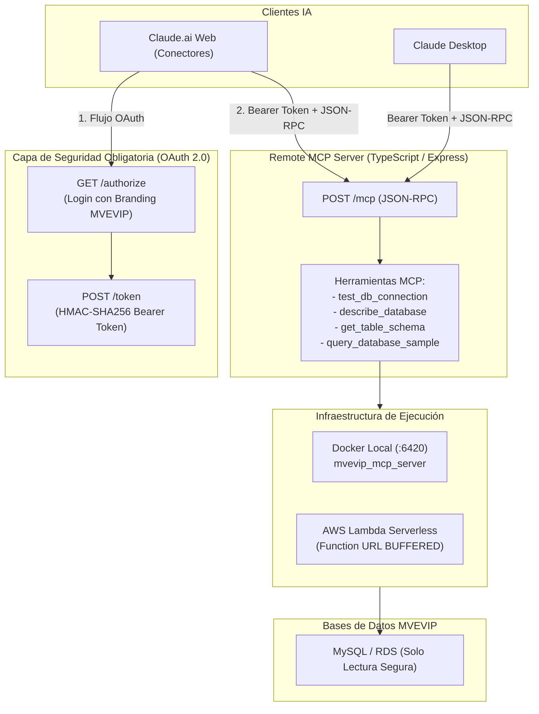

# MEMORIA TÉCNICA - MVEVIP REMOTE MCP SERVER PARA CLAUDE

**Proyecto:** Servidor Remote MCP MVEVIP (`mvevip_mcp`)  
**Fecha de Actualización:** 22 de Octubre de 2026  
**Infraestructura:** Docker Local (Puerto `6420`) + AWS Lambda Serverless (Function URL `BUFFERED` en `us-east-2` / `us-west-2`)  
**Repositorios:**
- Empresa (principal): [https://github.com/mvevip/mvevip-mcp](https://github.com/mvevip/mvevip-mcp)
- Personal (respaldo y actividad): [https://github.com/caloloc2/mvevip-mcp](https://github.com/caloloc2/mvevip-mcp) *(opcional al crearlo)*

---

## 1. Resumen Ejecutivo y Arquitectura

`mvevip_mcp` es un servidor Remote MCP (Model Context Protocol) desarrollado en **TypeScript / Node.js 20 / Express** que permite a Claude (Claude Desktop y Claude.ai Web) interactuar de forma segura e inteligente con las bases de datos relacionales de MVEVIP.

---

## 2. Componentes e Implementaciones Realizadas

### A. Ejecución Dual (Docker Local y AWS Lambda)
* **Modo Docker Local:** Servidor corriendo y probado en el puerto `6420` (`docker-compose.yml`, `Dockerfile` multi-stage Node.js 20 Alpine).
* **Modo AWS Lambda Serverless:** Adaptador `serverless-http` en `src/lambda.ts` configurado para responder mediante Function URL con modo de invocación `BUFFERED`.

### B. Flujo de Seguridad Obligatorio (OAuth 2.0 Login Gate)
* **Bloqueo Absoluto:** Ningún cliente (Claude Web o Desktop) puede acceder al endpoint `/mcp` sin autenticación previa (HTTP 401 Unauthorized sin token).
* **Login Corporativo (`src/auth/loginView.ts`):** Pantalla web moderna con branding MVEVIP en `GET /authorize`.
* **Criptografía Stateless (`src/auth/tokenManager.ts`):** Códigos temporales firmados con HMAC-SHA256 (TTL 5 min) y Bearer Tokens de larga duración (30 días).

### C. Herramientas MCP Operativas
1. `test_db_connection`: Evalúa ping, latencia, versión de MySQL y estado de la conexión.
2. `describe_database`: Catálogo de tablas con conteo estimado de filas, tamaño y comentarios.
3. `get_table_schema`: Estructura detallada de columnas, tipos de datos, nulabilidad e índices.
4. `query_database_sample`: Ejecución de consultas `SELECT`, `SHOW` y `DESCRIBE` con límites automáticos y bloqueo de sentencias mutantes (`INSERT`, `UPDATE`, `DELETE`, `DROP`).

### D. Automatización de Empaquetado y Despliegue
* `build_zip.ps1`: Compila TypeScript y genera el artefacto optimizado `function.zip` (~2.76 MB).
* `deploy_aws.ps1`: Automatiza el despliegue a AWS Lambda con el perfil `--profile marketingvip`.
* `scripts/test_local.ps1` y `scripts/test_local.js`: Batería completa de pruebas locales automatizadas.

---

## 3. Estado Actual y Tareas Pendientes

### ✅ Estado Actual
* Servidor local Dockerizado y probado al 100% en puerto `6420`.
* Flujo OAuth 2.0 y herramientas MCP verificadas en pruebas end-to-end.
* Código TypeScript limpio, modular y tipado con Zod y MCP SDK.

### ⏳ Pendientes / Próximos Pasos
1. **Configuración de Base de Datos Real en `.env`:**
   * Reemplazar parámetros en `.env` con el host real de la base de datos (IP o RDS).
2. **Herramientas de Negocio Específicas:**
   * Diseñar funciones dedicadas (ej: reportes de ventas por asesor y líder) con SQL optimizado para evitar inferencia heurística por parte del LLM.
3. **Despliegue a AWS Lambda y Conexión en Claude.ai:**
   * Ejecutar `deploy_aws.ps1` con perfil `marketingvip`.
   * Registrar la Function URL en Claude.ai (**Personalizar > Conectores**).

---

## 4. Actualización 22-oct-2026: Seguridad y CI/CD

* **Seguridad:** `MCP_ACCESS_KEY` y `MCP_SIGNING_SECRET` obligatorias (sin valores por defecto, secreto de firma separado);
  `/mcp` exige token en todas las llamadas (401 con `WWW-Authenticate`); OAuth con PKCE S256, `redirect_uri` en lista
  blanca, `client_id` validado, cliente público (sin `client_secret` fijo); límite de intentos de login; CORS restringido;
  logs sin secretos ni SQL; SQL validado con scrubber (sin multi-sentencia, `INTO OUTFILE`, `SLEEP`, etc.), transacción
  `READ ONLY`, timeout de 15 s y tope de filas.
* **MCP:** errores de herramientas con `isError`, `-32602` para parámetros inválidos, 202 en notificaciones.
* **Pruebas:** `npm test` (40 pruebas: flujo OAuth, PKCE, rate limit, guard SQL). Reemplaza `scripts/test_local.*`.
* **CI/CD:** `.github/workflows/ci.yml` y `deploy.yml` (manual, OIDC hacia AWS, CloudFormation en `infra/`). Ver `docs/DEPLOY.md`.
* **Pendiente de configurar por el equipo:** rol OIDC, secrets/variables del environment `production`, usuario MySQL de solo lectura.
