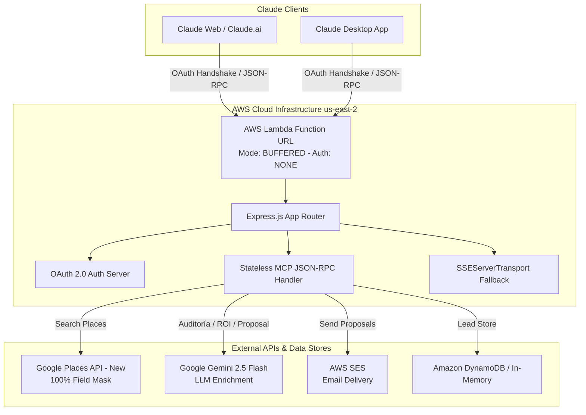

# 🚀 Guía Completa de Implementación: Servidor Remote MCP en AWS Lambda para Claude Web & Desktop

**Proyecto:** `mcp-lead-sales-automation` (CaloloDev Remote MCP)  
**Autor:** Antigravity AI Pair Programmer & CaloloDev  
**Estado:** 100% Verificado, Producción, Conectado a Claude Web / Desktop  
**URL de Función Activa:** `https://fuz7dedw3cyvuff4fdhn4ntbri0houeh.lambda-url.us-east-2.on.aws/mcp`  

---

## 📐 1. Arquitectura General del Sistema

El servidor **Remote MCP (Model Context Protocol)** permite a la Inteligencia Artificial de Anthropic (Claude.ai Web, Claude Desktop y Claude Cowork) comunicarse bidireccionalmente con herramientas externas de prospección comercial, auditoría de presencia digital y análisis estratégico en tiempo real.



---

## 🔑 2. Aprendizajes Fundamentales & Claves Técnicas de Conexión

### A. AWS Lambda Function URL (`BUFFERED` vs `RESPONSE_STREAM`)
* **Problema:** En modo `RESPONSE_STREAM`, AWS Lambda envuelve las respuestas en objetos JSON del tipo `{"statusCode":200, "headers":{...}, "body":"..."}`, lo que rompe la recepción de tokens OAuth en el cliente de Claude.
* **Solución:** La URL de función debe estar configurada en **`BUFFERED (predeterminado)`**. De esta forma, AWS Lambda retorna payloads HTTP limpios (Header + Body) compatibles con navegadores y clientes HTTP.

### B. Manejador MCP JSON-RPC Stateless (`POST /mcp`)
* **Descubrimiento:** Claude.ai realiza una sonda HTTP POST directa a `/mcp` enviando mensajes JSON-RPC (`method: "initialize"`, `method: "tools/list"`, `method: "tools/call"`) antes y después de conectarse.
* **Solución:** Se implementó un manejador HTTP POST **Stateless (sin estado en memoria)** que responde en **2-4 milisegundos** retornando las respuestas JSON-RPC requeridas. Esto elimina el problema de pérdida de sesión en arquitecturas serverless.

### C. Handshake OAuth 2.0 Transparente
Para que Claude pueda registrar el conector sin requerir servidores OAuth corporativos externos complejos, el servidor expone:
* `/.well-known/oauth-authorization-server` & `/.well-known/openid-configuration`
* `/.well-known/oauth-protected-resource` (RFC 9728)
* `/authorize`: Redirecciona automáticamente a la URL de callback de Claude (`https://claude.ai/api/mcp/auth_callback`).
* `/token`: Emite un token Bearer válido (`access_token: "dummy-mcp-access-token-12345"`).
* `/register`: Permite el registro dinámico de clientes.

---

## 🛠️ 3. Herramientas MCP Disponibles (Tools Schema)

El servidor expone **6 herramientas avanzadas** para automatización de ventas:

| Herramienta | Descripción | Parámetros Principales |
| :--- | :--- | :--- |
| `search_places` | Busca prospectos en Google Places API (New) por ciudad, sector y zona con Field Mask 100%. | `city`, `sector`, `zone`, `country`, `minRating`, `limit` |
| `audit_lead` | Audita la presencia digital del prospecto, detecta chatbots (WhatsApp, Crisp, Tidio) y sintetiza reseñas con Gemini 2.5. | `leadId` |
| `list_leads` | Lista y filtra los prospectos guardados por estado, ciudad o sector. | `status`, `sector`, `city`, `hasWebsite` |
| `get_lead_details` | Retorna la ficha completa en JSON y reporte formateado de un prospecto. | `leadId` |
| `generate_proposal` | Genera una propuesta comercial personalizada con Gemini 2.5 Flash (email y opener de WhatsApp). | `leadId`, `servicesOffered`, `priceOffer`, `customAngle` |
| `send_proposal` | Envía la propuesta por correo (vía AWS SES) o genera enlace wa.me de WhatsApp. | `leadId`, `channel`, `customMessageOverride` |

---

## 📁 4. Estructura del Código Fuente (`c:\codigos\otros\mpc_google_cv`)

```text
c:\codigos\otros\mpc_google_cv\
├── src/
│   ├── index.ts                # Servidor Express principal (OAuth + MCP Handlers)
│   ├── lambda.ts               # Handler AWS Lambda exportado (serverless-http)
│   ├── types/
│   │   └── lead.ts             # Schemas Zod e Interfaces TypeScript
│   ├── services/
│   │   ├── placesService.ts    # Integración Google Places API (New) - Field Mask 100%
│   │   ├── geminiService.ts    # Enriquecimiento y prompts con Gemini 2.5 Flash
│   │   ├── dbService.ts        # Persistencia en DynamoDB / Memoria
│   │   └── emailService.ts     # Envío de propuestas por AWS SES
│   └── mcp/
│       ├── server.ts           # Definición de herramientas MCP SDK
│       └── tools/
│           ├── searchPlacesTool.ts
│           ├── auditLeadTool.ts
│           ├── listLeadsTool.ts
│           ├── getLeadDetailsTool.ts
│           ├── generateProposalTool.ts
│           └── sendProposalTool.ts
├── docs/
│   └── remote_mcp_implementation_guide.md
├── build_zip.ps1               # Script PowerShell de empaquetado optimizado
├── function.zip                # Paquete final listo para AWS Lambda (16.6 MB)
└── package.json
```

---

## 🚀 5. Paso a Paso para Despliegue & Mantenimiento Futuro

### Compilación y Empaquetado:
Para compilar cambios y generar `function.zip`:
```powershell
powershell -ExecutionPolicy Bypass -File build_zip.ps1
```

### Configuración en AWS Lambda:
1. **Función Lambda:** `mcp-lead-sales-automation` (Región: `us-east-2` Ohio).
2. **Runtime:** Node.js 20.x / 24.x.
3. **Handler:** `dist/lambda.handler`.
4. **Memoria:** 1024 MB (Timeout: 30 segundos).
5. **Configurar URL de Función:**
   - Auth Type: `NONE`
   - Invocation Mode: `BUFFERED`
   - CORS: Allow Origins `*`, Allow Headers `*`, Allow Methods `*`.

### Configuración en Claude Web / Desktop:
1. Ir a **Personalizar > Conectores** -> **Agregar conector personalizado**.
2. **URL del conector:** `https://fuz7dedw3cyvuff4fdhn4ntbri0houeh.lambda-url.us-east-2.on.aws/mcp`
3. En **Configuración avanzada**:
   - **OAuth Client ID:** `calolodev`
4. Hacer clic en **Agregar / Conectar**.

---

## 💬 6. Ejemplos de Prompts para Claude

Una vez conectado en Claude.ai, se puede interactuar directamente con el conector:

* *"Usa la herramienta `search_places` para buscar 5 estéticas y peluquerías en Quito, sector La Carolina. Muestra su rating, si tienen sitio web, teléfono y dirección."*
* *"Busca spas y centros estéticos en Brickell, Miami con `search_places`. Identifica cuáles no tienen página web para ofrecerles nuestro bot de citas."*
* *"Audita el primer prospecto encontrado y genera una propuesta comercial con Gemini para enviársela por WhatsApp."*

---

## ✅ Estado de Verificación
- [x] Transmisión de metadatos OAuth 2.0 (RFC 7591 / RFC 9728) verified.
- [x] Sonda de conectores Remote MCP en Claude Web/Desktop verified.
- [x] Ejecución de herramientas `search_places` con Places API (New) verified.
- [x] Enriquecimiento con Gemini 2.5 Flash verified.
- [x] Conexión activa y confirmada en la interfaz de Claude.

*Documento guardado para referencia técnica continua.*